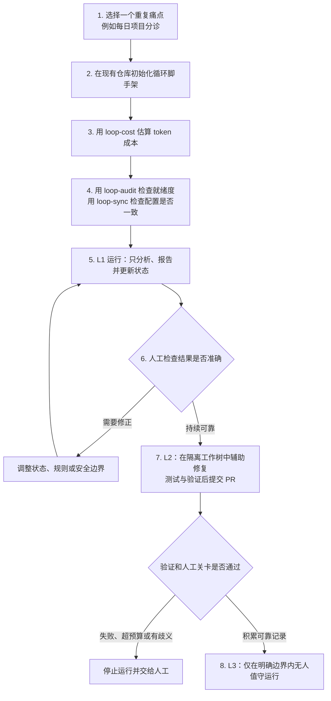
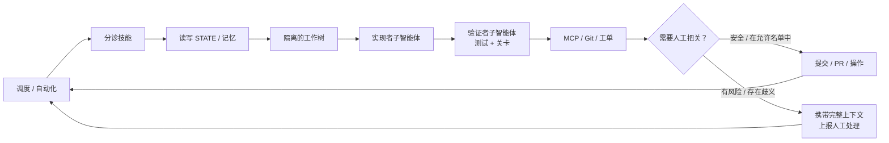

# Loop Engineering

简体中文 · [English / 原项目](https://github.com/cobusgreyling/loop-engineering)

<p align="center">
  <a href="https://cobusgreyling.github.io/loop-engineering/">
    
  </a>
</p>

<p align="center">
  <a href="https://github.com/cobusgreyling/loop-engineering/stargazers"></a>
  <a href="https://github.com/cobusgreyling/loop-engineering/actions/workflows/audit.yml"></a>
  <a href="https://www.npmjs.com/package/@cobusgreyling/loop-audit"></a>
  <a href="https://www.npmjs.com/package/@cobusgreyling/loop-init"></a>
  <a href="https://www.npmjs.com/package/@cobusgreyling/loop-cost"></a>
  <a href="https://www.npmjs.com/package/@cobusgreyling/loop-sync"></a>
  <a href="https://www.npmjs.com/package/@cobusgreyling/loop-context"></a>
  <a href="https://www.npmjs.com/package/@cobusgreyling/loop-mcp-server"></a>
  <a href="https://www.npmjs.com/package/@cobusgreyling/loop-worktree"></a>
  <a href="https://github.com/cobusgreyling/loop-engineering/blob/main/LICENSE"></a>
  <a href="https://cobusgreyling.github.io/loop-engineering/"></a>
</p>


<p align="center">
  <a href="https://cobusgreyling.github.io/loop-engineering/">
    
  </a>
</p>

> **别再亲自写提示词。设计循环，获得评分。**

<p align="center">
  
</p>

<a id="what-is-loop-engineering"></a>
## 先用一句话理解这个项目

**Loop Engineering（循环工程）是一套面向 AI 编码智能体的实用模式、起步模板和 CLI 工具：它帮助你设计能够持续向智能体下达任务并编排其工作的系统。**其理念受到 Addy Osmani 与 Boris Cherny 等人的启发；仓库内包含 `loop-audit`、`loop-init`、`loop-cost` 等可直接使用的工具。

它**不是某个新的 AI 模型或编码工具**，也不是一句万能提示词。它关心的是：怎样把原本需要人反复执行的“打开项目 → 描述任务 → 检查结果 → 记录进度”，整理成一套可重复、可检查、可暂停的工程系统。

这套系统通常包含：

| 组成部分 | 通俗解释 |
|---|---|
| 提示词 / 技能 | 告诉智能体每次要做什么、什么不能做 |
| 调度 | 决定何时运行，例如每天一次或每 15 分钟一次 |
| 状态 / 记忆 | 把进度写进文件，下一次运行不必依赖旧对话 |
| 预算 | 限制运行次数、token 消耗和子智能体数量 |
| 验证 | 用测试、检查器或独立智能体验证结果 |
| 人工关卡 | 遇到高风险、歧义或合并操作时交给人决定 |

换句话说：**你仍然负责编写目标和安全边界，但不必每天手工重复同一套提示、检查与记录动作。**

<a id="how-the-loop-works"></a>
## 从一个痛点到可靠循环

下面这张图是整个快速入门的地图。第一次使用时停在 **L1（只报告）** 就够了；L2、L3 是积累了可靠运行记录后的渐进升级，不是安装完成后立即开启的“全自动模式”。



### “初始化脚手架”到底是什么意思？

这里的**脚手架不是业务代码生成器**。它不会替你创建网页、接口或数据库，而是在你**已有的 Git 仓库**中创建运行循环所需的配置、状态、预算和日志文件，例如：

- `STATE.md`：记录当前优先事项、观察项和最近一次运行结果；
- `LOOP.md`：描述循环的运行方式、节奏和人工关卡；
- `loop-budget.md`：记录运行次数与 token 上限；
- `loop-run-log.md`：追加保存每次运行的历史；
- 对应工具的技能与约束文件：告诉智能体如何执行并在何时停止。

下面的命令就是把这套“循环运行框架”放进当前目录（`.`）中：

```bash
npx @cobusgreyling/loop-init .
```

`loop-init` 随后会输出你的 **Loop Ready** 评分以及第一条循环命令。可将 `--tool` 的值换成 `claude`、`codex` 或 `opencode`。更完整、可复制的命令见[快速入门](docs/QUICKSTART.md)。

<p align="center">
  <a href="docs/QUICKSTART.md">
    
  </a>
</p>

<a id="daily-triage-example"></a>
## 一个具体例子：每日项目分诊

假设你每天开始工作前，都会让 AI 查看仓库最近的变化、CI 状态和待处理事项，再整理出“今天最需要关注什么”。普通用法是每天重新描述要求、粘贴上下文并手工保存结论；`daily-triage` 循环则把这套动作固化下来：

1. 调度器每天触发一次 `loop-triage`；
2. 智能体先读取 `STATE.md`，避免每次从空白对话开始；
3. 它检查仓库情况，把发现合并到“高优先级”和“观察列表”，并更新最近运行时间；
4. 第一周保持 L1，只生成报告和更新状态，**不修改代码**；
5. 人工每天快速核对结果，确认它有没有漏报、误报或越界；
6. 只有在连续运行可靠后，才考虑通过工作树、验证器和 PR 进入 L2 辅助修复。

这样做的价值不只是“少写几次提示词”，而是让任务有固定输入、持久状态、成本上限、可追踪输出和明确的人工责任。

<a id="who-is-it-for"></a>
## 适合哪些人？

- 已在使用 Grok、Claude Code、Codex、Cursor、Opencode 等 AI 编码智能体，并且有重复维护工作的开发者；
- 想自动处理分诊、PR 看护、CI 清理、依赖检查或变更日志，但不愿直接放开自动改码、自动合并的人；
- 需要让智能体跨多次运行保留状态，同时控制 token 成本和失败重试的人；
- 正在为团队设计 AI 工程规范，希望每次运行都有日志、验证和人工审批边界的人。

如果你只是偶尔问一次代码问题，不需要持续调度、状态文件或安全关卡，那么直接使用现有 AI 编码工具即可，不必先搭建循环。

**初次了解？** [快速入门（5 分钟）](docs/QUICKSTART.md) · [交互式选择器](https://cobusgreyling.github.io/loop-engineering/#interactive)

面向使用 Grok、Claude Code、Codex、Cursor 及其他 AI 编码智能体的开发者。

<p align="center">
  <strong><a href="https://cobusgreyling.github.io/loop-engineering/">→ 交互式成果展示与模式选择器</a></strong>
  ·
  <a href="https://cobusgreyling.substack.com/p/loop-engineering">文章</a>
  ·
  <a href="https://addyosmani.com/blog/loop-engineering/">Addy Osmani</a>
</p>

<a id="chinese-edition-direction"></a>
## 中文版的方向：从翻译走向知识导航

这个中文版希望在保留上游技术事实、命令、参数和智能体指令的前提下，把抽象概念改写成中文读者容易理解的“问题 → 场景 → 流程 → 命令 → 风险”路径。长期目标不只是翻译单个仓库，还包括把值得学习的开源项目和工具整理成可搜索、可比较、可动手实践的知识导航，并逐步沉淀为脚本或 App。产品形态、数据结构和迭代路线见 [中文版产品规划](docs/PRODUCT_PLAN.md)。

<a id="contents"></a>
## 目录

- [先用一句话理解这个项目](#what-is-loop-engineering)
- [从一个痛点到可靠循环](#how-the-loop-works)
- [一个具体例子：每日项目分诊](#daily-triage-example)
- [适合哪些人？](#who-is-it-for)
- [中文版的方向：从翻译走向知识导航](#chinese-edition-direction)
- [快速入门（5 分钟）](docs/QUICKSTART.md)
- [快速链接](#quick-links)
- [为何如此重要](#why-this-matters)
- [五大构建模块与记忆](#the-five-building-blocks--memory)
- [模式](#patterns)
- [开始使用（5 分钟）](#getting-started-5-minutes)
- [按工具分类的示例](#examples-by-tool)
- [运行与安全](#operating--safety)
- [注意事项](#caveats)
- [参与贡献](#contributing)
- [资料来源](#sources)
- [许可证](#license)

<a id="quick-links"></a>
## 快速链接

| 从这里开始 | 说明 |
|------------|-------------|
| [快速入门（5 分钟）](docs/QUICKSTART.md) | 搭建 → 成本检查 → 审计 → 首次循环——**初次到访请从这里开始** |
| [Loop Engineering 文章](https://cobusgreyling.substack.com/p/loop-engineering) | 概念、原语及其与 Grok 的对应关系——阅读它以理解缘由 |
| [模式选择器](docs/pattern-picker.md) | 确定先运行哪个循环——**不确定时从这里开始** |
| [原语矩阵](docs/primitives-matrix.md) | 跨工具的循环原语映射——建议收藏 |
| [循环设计检查清单](docs/loop-design-checklist.md) | 发布就绪度评估标准 |
| [模式](patterns/README.md) | 7 种生产模式及[交互式选择器](https://cobusgreyling.github.io/loop-engineering/#interactive) |
| [入门模板](starters/) | 克隆即可运行的套件（Grok、Claude Code、Codex、Opencode） |
| [Opencode 示例](examples/opencode/) | CLI 优先的循环：cron/systemd + `opencode run`、技能、工作树 |
| [loop-audit](tools/loop-audit/) | 循环就绪度评分 CLI（v1.6——约束与治理评分）——`npx @cobusgreyling/loop-audit . --suggest` · 使用 `--badge` 生成 README 徽章 |
| [loop-init](tools/loop-init/) | 搭建入门模板、预算/运行日志及约束（v1.4）——`npx @cobusgreyling/loop-init . --pattern daily-triage --tool grok` |
| [loop-cost](tools/loop-cost/) | Token 开销估算器——`npx @cobusgreyling/loop-cost` |
| [loop-sync](tools/loop-sync/) | 检测 `STATE.md` 与 `LOOP.md` 之间的偏移——`npx @cobusgreyling/loop-sync .` |
| [loop-context](tools/loop-context/) | 面向长时间运行任务的有状态记忆管理器与熔断器——`npx @cobusgreyling/loop-context --check --ledger run.json` |
| [loop-mcp-server](tools/mcp-server/) | 在运行时通过 MCP 查询模式、技能和状态——`npx @cobusgreyling/loop-mcp-server` |
| [loop-worktree](tools/loop-worktree/) | 为每次修复尝试管理隔离的 Git 工作树——`npx @cobusgreyling/loop-worktree create --run-id <id> --pattern <p>` |
| [Goal Engineering](https://github.com/cobusgreyling/goal-engineering) | **配套项目：**循环负责发现，目标负责完成——`/goal` + [组合使用手册](https://github.com/cobusgreyling/goal-engineering/blob/main/docs/stack-cookbook.md)（`npx @cobusgreyling/goal doctor .`） |
| [故事](stories/) | 真实的成功经验与坦诚的失败记录 |
| [贡献者快速入门](https://github.com/cobusgreyling/loop-engineering/discussions/123) | **期待你的帮助：**21 个范围明确的 `good first issues`——评论 *I'll take this* 即可认领 |
| [社区动态](https://github.com/cobusgreyling/loop-engineering/discussions/145) | **7 月 4 日：**5.5k 星标、流量来源及贡献者合并记录 |
| [社区周报（7 月 8 日）](https://github.com/cobusgreyling/loop-engineering/discussions/219) | loop-worktree npm、MCP 快速入门、工具附录 |
| [维护记录（7 月 10 日）](https://github.com/cobusgreyling/loop-engineering/discussions/241) | 文档同步、分支清理及 loop-audit 1.6.0 后续事项 |
| [以往版本说明](https://github.com/cobusgreyling/loop-engineering/discussions/89) | v1.5.0——loop-sync、约束、MCP server |
| [添加你的项目](https://github.com/cobusgreyling/loop-engineering/discussions/92) | **置顶：**Loop Ready 徽章与采用者列表 |

<p align="center">
  
</p>

<a id="why-this-matters"></a>
## 为何如此重要

Peter Steinberger:
> “你不该再亲自向编码智能体发出提示。你应该设计能向智能体发出提示的循环。”

Boris Cherny（Anthropic Claude Code 负责人）：
> “我不再亲自向 Claude 发出提示。我让循环持续运行，由它们提示 Claude 并判断该做什么。我的工作是编写循环。”

杠杆点已经从编写单个提示词，转向设计能够长期编排智能体的控制系统。

<a id="the-five-building-blocks--memory"></a>
## 五大构建模块与记忆

| 原语 | 在循环中的职责 |
|-----------|-----------------|
| **自动化 / 调度** | 按固定节奏进行发现与分诊 |
| **工作树** | 安全的并行执行环境 |
| **技能** | 持久化的项目知识 |
| **插件与连接器** | 接入实际使用的工具（MCP） |
| **子智能体** | 分离执行者与检查者 |
| **+ 记忆 / 状态** | 独立于任何对话的持久化主干 |

完整说明：[docs/primitives.md](docs/primitives.md) · 跨工具矩阵：[docs/primitives-matrix.md](docs/primitives-matrix.md)

<a id="visual-overview"></a>
### 可视化概览

<p align="center">
  
</p>

<a id="anatomy-of-a-loop"></a>
### 循环剖析

<p align="center">
  
</p>

<details>
<summary>Mermaid 图（便于复制）</summary>



</details>

**这个参考仓库现在会在每次 push/PR 时运行自身的 `validate-patterns` 和 `audit` 工作流**（参见 `.github/workflows/`）。我们还添加了 `LOOP.md`，用于说明维护本仓库的循环。

<a id="patterns"></a>
## 模式

<p align="center">
  
</p>

| 模式 | 运行节奏 | 入门模板 | 第 1 周 | token 成本 |
|---------|---------|---------|--------|------------|
| [每日分诊](patterns/daily-triage.md) | 1d–2h | [minimal-loop](starters/minimal-loop/) | **L1** 报告 | 低 |
| [PR 看护](patterns/pr-babysitter.md) | 5–15m | [pr-babysitter](starters/pr-babysitter/) | L1 监控 | 高 |
| [CI 清理](patterns/ci-sweeper.md) | 5–15m | [ci-sweeper](starters/ci-sweeper/) | L2 谨慎执行 | 极高 |
| [依赖清理](patterns/dependency-sweeper.md) | 6h–1d | [dependency-sweeper](starters/dependency-sweeper/) | L2 仅补丁 | 中 |
| [变更日志起草](patterns/changelog-drafter.md) | 1d 或创建标签时 | [changelog-drafter](starters/changelog-drafter/) | **L1** 草稿 | 低 |
| [合并后清理](patterns/post-merge-cleanup.md) | 1d–6h | [post-merge-cleanup](starters/post-merge-cleanup/) | **L1** 非高峰期 | 低 |
| [Issue 分诊](patterns/issue-triage.md) | 2h–1d | [issue-triage](starters/issue-triage/) | **L1** 仅建议 | 低 |

不确定该选择哪一个？请试试[交互式选择器](https://cobusgreyling.github.io/loop-engineering/#interactive)或[模式选择器](docs/pattern-picker.md)。

机器可读索引：[patterns/registry.yaml](patterns/registry.yaml)（7 种模式）

<a id="getting-started-5-minutes"></a>
## 开始使用（5 分钟）

> 中文说明：以下代码块中的命令及智能体指令保持英文原文，说明性注释已中文化。

```bash
# 1. 搭建项目并获取 Loop Ready 评分（自动输出）
npx @cobusgreyling/loop-init . --pattern daily-triage --tool grok

# 2. 估算当前运行节奏下的 token 开销
npx @cobusgreyling/loop-cost --pattern daily-triage --level L1

# 3. 改进后重新审计
npx @cobusgreyling/loop-audit . --suggest

# 可选：将 Loop Ready 徽章粘贴到 README 中
npx @cobusgreyling/loop-audit . --badge

# 4. 查看评分提升过程：空项目 → L1 → L2
bash scripts/before-after-demo.sh

# 5. 从仅报告模式开始（Grok 示例）
/loop 1d Run loop-triage. Update STATE.md. No auto-fix in week one.
```

所有 npm CLI 均从带标签的版本发布——参见 [docs/RELEASE.md](docs/RELEASE.md)。无需克隆仓库。

**从源代码开发**（单体仓库贡献者）：

```bash
cd tools/loop-init && npm ci && npm test && node dist/cli.js /path/to/project --pattern daily-triage --tool grok
cd tools/loop-audit && npm ci && npm test && node dist/cli.js /path/to/project --suggest
cd tools/loop-cost && npm ci && npm test && node dist/cli.js --pattern ci-sweeper --cadence 15m
```

分阶段启用：**L1 报告 → L2 辅助修复 → L3 无人值守**——参见[循环设计检查清单](docs/loop-design-checklist.md)。

<a id="examples-by-tool"></a>
## 按工具分类的示例

- [Grok](examples/grok/daily-triage.md)
- [Claude Code](examples/claude-code/)
- [Codex](examples/codex/)
- [OpenClaw](examples/openclaw/daily-triage.md)
- [Opencode](examples/opencode/)
- [GitHub Actions](examples/github-actions/)

<a id="operating--safety"></a>
## 运行与安全

- [失效模式](docs/failure-modes.md)——以事件记录形式整理的问题目录
- [反模式](docs/anti-patterns.md)——投入生产前应避免的设计错误
- [多循环协调](docs/multi-loop.md)——循环发生冲突时如何处理
- [循环运行指南](docs/operating-loops.md)——成本、日志记录及何时终止运行
- [安全](docs/safety.md)——拒绝名单、自动合并及 MCP 权限范围
- [安全保障](SECURITY.md)——问题报告与无人值守自动化的风险
- [概念](docs/concepts.md)——意图债务、理解债务、智能体运行框架与循环的区别
- [MCP 实用手册](examples/mcp/)——按模式分类的连接器示例

<a id="caveats"></a>
## 注意事项

循环工程会放大判断力——无论判断是好是坏。

- 使用子智能体和长时间运行的循环时，**token 成本**可能急剧增加。
- **验证责任仍然在你。**无人值守的循环也会犯下无人察觉的错误。
- 除非你认真阅读循环交付的内容，否则**理解债务**会加速累积。
- 两个人运行相同的循环，可能得到截然相反的结果。循环并不知道这一点，但你知道。

Addy Osmani:
> “构建循环，但要以一个仍想坚守工程师职责的人来构建，而不是只做那个按下启动按钮的人。”

<a id="help-wanted"></a>
## 期待你的帮助

**第一次提交 PR？**请从[贡献者快速入门](https://github.com/cobusgreyling/loop-engineering/discussions/123)开始——任务用时约 10 分钟至 1 小时，故事和采用者相关提交可在当天获得审查。已完成贡献的成员请参见 [CONTRIBUTORS.md](CONTRIBUTORS.md)。

| 选择一项 | 议题 |
|----------|-------|
| 约 10 分钟 | [#120——将你的项目添加到采用者列表](https://github.com/cobusgreyling/loop-engineering/issues/120) |
| 约 15 分钟 | [#118——每日分诊故事](https://github.com/cobusgreyling/loop-engineering/issues/118) · [#119——PR 看护失败故事](https://github.com/cobusgreyling/loop-engineering/issues/119) |
| 约 15 分钟 | [#226——在 QUICKSTART 中添加 `loop-sync` 小节](https://github.com/cobusgreyling/loop-engineering/issues/226) |
| 约 20 分钟 | [#117——在原语矩阵中添加 Continue.dev 行](https://github.com/cobusgreyling/loop-engineering/issues/117) |
| 约 30 分钟 | [#147——Cline 附录](https://github.com/cobusgreyling/loop-engineering/issues/147) · [#220——Cursor CI 清理示例](https://github.com/cobusgreyling/loop-engineering/issues/220) |
| 约 30 分钟 | [#221——Cursor 合并后清理](https://github.com/cobusgreyling/loop-engineering/issues/221) · [#224——Cursor Issue 分诊](https://github.com/cobusgreyling/loop-engineering/issues/224) |
| 约 30 分钟 | [#195——Roo Code 附录](https://github.com/cobusgreyling/loop-engineering/issues/195) · [#196——GitHub Copilot 附录](https://github.com/cobusgreyling/loop-engineering/issues/196) |
| 约 45 分钟 | [#225——Hermes PR 看护示例](https://github.com/cobusgreyling/loop-engineering/issues/225) · [#231——loop-init 验证检查清单](https://github.com/cobusgreyling/loop-engineering/issues/231) |
| 约 1 小时 | [#229](https://github.com/cobusgreyling/loop-engineering/issues/229) / [#230](https://github.com/cobusgreyling/loop-engineering/issues/230)——**你的故事**（工作树第二周、多循环失败） |
| 约 1 小时 | [#173——Issue 分诊第一周故事](https://github.com/cobusgreyling/loop-engineering/issues/173) |

在任意 [`good first issue`](https://github.com/cobusgreyling/loop-engineering/issues?q=is%3Aissue+is%3Aopen+label%3A%22good+first+issue%22) 下评论 **"I'll take this"** 即可认领。

<a id="contributing"></a>
## 参与贡献

欢迎分享生产模式、工具映射和失败故事。请参阅 [CONTRIBUTING.md](CONTRIBUTING.md)（贡献阶梯及 [`good first issue` 待办列表](https://github.com/cobusgreyling/loop-engineering/issues?q=is%3Aissue+is%3Aopen+label%3A%22good+first+issue%22)）、[采用者](docs/adopters.md)以及 [GitHub Discussions](https://github.com/cobusgreyling/loop-engineering/discussions)。

<a id="sources"></a>
## 资料来源

- [Cobus Greyling – Loop Engineering (Substack)](https://cobusgreyling.substack.com/p/loop-engineering)
- [Addy Osmani – Loop Engineering](https://addyosmani.com/blog/loop-engineering/)
- [来源说明与延伸阅读](resources/sources.md)

<a id="license"></a>
## 许可证

MIT

---

*这是一份注重实用性和工具适配的循环工程参考资料：包含可克隆的模式、可用于交付把关的检查清单，以及如实记录问题的故事。*

<p align="center">
  <a href="https://cobusgreyling.substack.com/p/loop-engineering">文章</a>
  ·
  <a href="https://cobusgreyling.github.io/loop-engineering/">成果展示</a>
  ·
  <a href="https://github.com/cobusgreyling">Cobus Greyling</a>
</p>

<p align="center">
  <a href="https://cobusgreyling.github.io/loop-engineering/star-history.html">
    <picture>
      <source media="(prefers-color-scheme: dark)" srcset="assets/visuals/star-history-dark.svg" />
      <source media="(prefers-color-scheme: light)" srcset="assets/visuals/star-history.svg" />
      
    </picture>
  </a>
</p>
<p align="center"><sub>静态图表（由 CI 每日更新）。<a href="https://cobusgreyling.github.io/loop-engineering/star-history.html">实时图表</a>需要 GitHub token——且仅存储在你的浏览器中。</sub></p>
