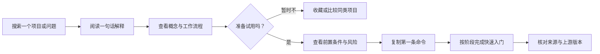
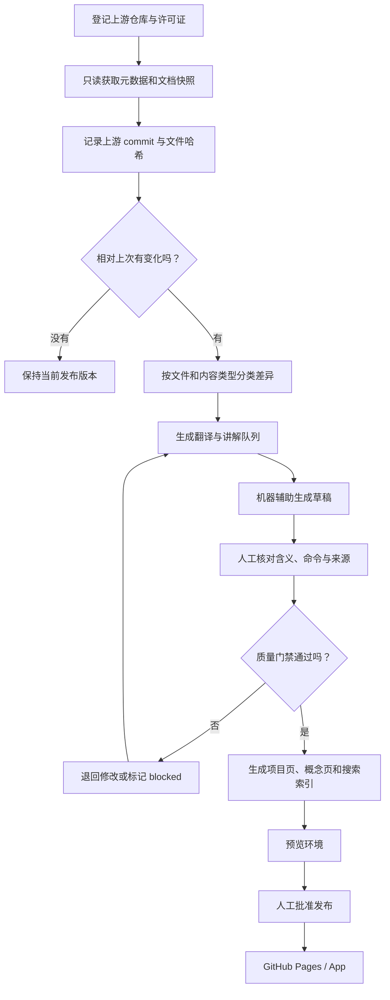

# 从中文 Fork 到开源知识导航：产品路线图

> 这份文档规划的是中文版 fork 的下一步，不代表下面描述的功能已经存在。文中会明确标注“当前已有”和“建议新增”。

## 一句话说清楚要做什么

把一个读起来很抽象的开源工具项目，整理成中国开发者可以快速看懂、敢于试用、能够核对原文的中文知识条目；再把这套整理方法做成脚本、网站，最终扩展为可搜索的开源知识导航。

它不只是“把英文翻译成中文”，还要回答用户真正关心的问题：

1. 这个项目解决什么问题？
2. 它适合谁，不适合谁？
3. 第一次应该运行哪条命令？
4. 每个阶段实际发生了什么？
5. 有哪些成本、权限和误操作风险？
6. 中文内容对应上游的哪个版本，是否已经过期？

## 1. 产品定位与边界

### 产品定位

这是一个“开源项目通俗化与知识导航”项目。核心价值不是收集更多链接，而是降低从“听说过”到“真正理解并完成第一次使用”的门槛。

每个收录项目至少应提供四层内容：

- **一句话解释**：不用原项目术语也能说明它解决什么问题。
- **概念翻译**：解释项目里的关键词，以及它们之间的关系。
- **操作路径**：用流程图、分阶段说明和可复制命令带用户完成第一次使用。
- **可信来源**：每条重要说明都能回到上游文件、版本或提交核对。

### 产品边界

本项目负责“理解、导航和安全试用”，不承诺替代上游项目：

- 不维护与上游长期分叉的功能实现，除非明确决定将某项能力产品化。
- 不把第三方项目包装成自己的原创成果；页面必须展示原仓库、许可证和来源版本。
- 不默认翻译命令、代码、配置键、文件路径和给智能体执行的 prompt。
- 不保证收录项目适用于所有用户；必须同时说明适用场景、限制和风险。
- 不在导入或构建过程中执行第三方仓库代码。

## 2. 当前已有与建议新增

### 当前已有

当前仓库已经具备：

- Loop Engineering 的简体中文文档、示例说明和快速入门。
- `patterns/registry.yaml` 这样的机器可读模式索引。
- `loop-init`、`loop-audit`、`loop-cost`、`loop-sync` 等 CLI 源码和说明。
- `/docs` 下的 GitHub Pages 展示页和交互式模式选择器。
- GitHub Actions 中的模式校验、审计及发布工作流。
- `scripts/check-translation-boundaries.mjs`：阻止受保护的命令、prompt、技能和模板被误加中文。
- `TRANSLATION_GUIDE.md`：说明哪些内容可以翻译，哪些内容要保留原文。

这些能力说明本仓库已经是一个合适的“第一个样板项目”，但它目前仍主要围绕单个上游仓库组织。

### 建议新增

要扩展为知识导航，还需要补齐：

- 多项目注册表与统一内容模型。
- 上游提交记录、变更检测和翻译状态。
- 待翻译、待复核、来源变化、发布阻塞等工作队列。
- 面向普通用户的项目页、概念页、流程页和命令卡片。
- 跨项目搜索、标签筛选和相关概念跳转。
- 从“发现上游变化”到“人工审核后发布”的流水线。

## 3. 目标用户与典型任务

| 用户 | 常见问题 | 产品应帮助他完成的任务 |
|---|---|---|
| 第一次接触项目的开发者 | “这到底是做什么的？” | 3 分钟内看懂用途、前置条件、主流程和风险 |
| 想立即试用的人 | “第一条命令是什么？” | 找到经过核对的最短路径，并理解命令会改什么 |
| 技术选型者 | “它和另一个工具有什么区别？” | 按场景、成熟度、成本、权限和部署方式比较 |
| 中文内容维护者 | “上游改了哪些文档？” | 看到文件级差异、影响范围和翻译队列 |
| 项目作者或贡献者 | “中文说明是否准确？” | 从中文结论跳回上游文件、行文出处和 commit |
| 知识导航运营者 | “哪些条目过期或缺少审核？” | 按状态筛选、分配审核并控制发布质量 |

典型用户路径如下：



## 4. 内容数据模型

建议把“页面内容”和“可查询事实”分开：Markdown 负责给人阅读，YAML/JSON 负责校验、检索和生成页面。不要一开始就建数据库，先在 Git 中保存结构化数据，保留完整审阅历史。

### 核心实体

| 实体 | 关键字段 | 用途 |
|---|---|---|
| 项目 `project` | `id`、中英文名、摘要、官网、仓库、许可证、主题标签、成熟度、维护状态 | 项目总入口和筛选维度 |
| 概念 `concept` | `id`、名称、通俗解释、原术语、相关项目、前置概念 | 把抽象术语解释成人能理解的语言 |
| 流程 `flow` | `id`、目标、阶段、输入、输出、人工关卡、失败分支 | 描述“每一步实际做什么”并生成流程图 |
| 工具 `tool` | `id`、类型、安装方式、运行环境、依赖、替代项 | 区分 CLI、库、服务、插件和 App |
| 命令 `command` | 原文命令、用途、前置条件、预期改动、风险等级、验证方式 | 形成可复制、可解释、可验证的命令卡片 |
| 风险 `risk` | 等级、影响、触发条件、缓解措施、是否需要人工确认 | 让“能运行”不等于“可以盲目运行” |
| 来源 `source` | 上游 URL、文件路径、commit、获取时间、内容摘要哈希 | 追踪中文结论来自哪里、是否发生变化 |
| 本地化状态 `localization` | 语言、状态、译者、复核者、更新时间、对应上游 commit | 管理翻译和审核生命周期 |

### 建议状态值

本地化状态采用有限状态，避免只有模糊的“已翻译”。主线为：

`discovered`（已发现）→ `queued`（待处理）→ `drafted`（已有草稿）→ `reviewed`（人工复核）→ `published`（已发布）。

`stale` 表示上游在复核或发布后发生了变化，内容需要回到 `queued` 并重新审核；`blocked` 不是主线的最后一步，而是任意阶段都可能因来源、许可证或准确性问题进入的阻塞状态。

### 建议的项目元数据示例

```yaml
id: loop-engineering
name: Loop Engineering
name_zh: 循环工程
summary_zh: 用可重复的流程编排 AI 编码智能体，而不是每次手写提示词。
repository: https://github.com/cobusgreyling/loop-engineering
license:
  spdx: MIT
  source: https://github.com/cobusgreyling/loop-engineering/blob/main/LICENSE
upstream:
  default_branch: main
  synced_commit: "<full-commit-sha>"
  checked_at: "<ISO-8601-time>"
localization:
  status: reviewed
  source_commit: "<full-commit-sha>"
  reviewer: "<github-handle>"
topics: [ai-agent, developer-tools, automation]
```

实际落库时应使用 JSON Schema 校验这些字段；示例里的占位符不能作为正式数据提交。

## 5. 产品流水线

下面的流程既适用于本仓库继续同步 Loop Engineering，也适用于未来导入其他项目：



流水线的关键原则：机器可以发现、分类和起草，但“命令是否安全”“prompt 是否保持原义”“总结是否忠于来源”必须经过规则检查和人工审核。

## 6. 分阶段路线

### 阶段 0：人工样板（当前阶段）

目标：先把 Loop Engineering 做成一份真正通俗、可核对的中文样板。

- 在 README 和 QuickStart 中补足概念解释、阶段说明和流程图。
- 对命令说明“作用、输入、输出、是否改文件、如何撤销或验证”。
- 保存原项目链接、许可证和当前同步 commit。
- 继续使用现有翻译边界检查，保留命令、配置和 prompt 原文。

完成标志：不了解 Loop Engineering 的开发者能在 5 分钟内说清它的用途，并能说明 `loop-init` 不是生成业务代码，而是在仓库中放入循环运行所需的状态、规则和预算文件。

### 阶段 1：半自动同步脚本

目标：解决维护者最费时间的工作——“上游哪里变了、哪些中文内容需要重看”。

建议新增 Node.js/TypeScript CLI：

```text
knowledge import <repo-url>     # 创建项目记录，只读取元数据和文档
knowledge sync <project-id>     # 获取新 commit，生成文件级差异
knowledge queue                 # 列出待翻译、待复核和已过期内容
knowledge check                # 校验结构、来源、链接和翻译边界
knowledge build                # 生成站点需要的 JSON 与页面
```

首版只支持公开 GitHub 仓库和人工维护的允许文件列表，不做任意代码托管平台的通用爬虫。翻译提供方使用适配器接口，允许人工翻译，也允许接入不同模型；脚本不得把密钥写入仓库。

### 阶段 2：可搜索静态知识站

目标：将结构化内容变成可发现、可分享、移动端可读的网站。

- 优先复用当前 GitHub Pages 和 `/docs`，先增加项目列表、标签筛选、详情页和客户端搜索。
- 构建时从注册表生成项目卡片、概念页、流程页、命令卡片和搜索索引。
- 每个页面展示“来源 commit、最后复核时间、翻译状态、查看原文”。
- Pull Request 自动生成预览或构建产物，人工确认后再合并发布。
- 当页面数量和组件复用明显增加时，再评估将 `/docs` 迁移到 Astro/Starlight 等静态内容框架；迁移不是 MVP 前置条件。

### 阶段 3：可搜索 App

只有出现下列真实需求时，才从静态站升级为带后端的 App：用户登录与收藏、个人知识路径、多人审核工作台、大规模全文检索、订阅上游变化或团队权限。

建议形态：

- 前端：TypeScript + React/Next.js（或团队更熟悉的同类方案）。
- API：与前端同仓的轻量 API，后续再按负载拆分。
- 数据：PostgreSQL 保存项目、来源、审核状态和用户数据；对象存储保存合法的快照或构建产物。
- 队列：后台任务执行仓库同步、链接检查和索引更新；任务必须幂等且可重试。
- 搜索：先用 PostgreSQL 全文检索；只有规模和相关性证明有必要时，再引入专用搜索服务。

这一步的代价是部署、数据库迁移、账号安全、备份和运维。没有用户协作与个性化需求时，静态站通常更省钱、更可靠。

## 7. 技术方案取舍

| 方案 | 组成 | 优点 | 代价 | 适用阶段 |
|---|---|---|---|---|
| 轻量脚本 + 现有 Pages | Node.js 脚本、YAML/Markdown、现有 `/docs`、GitHub Actions | 改动小、免费托管、Git 审核清晰、无后端 | 搜索和多人工作台能力有限 | 阶段 0–2，推荐先做 |
| 静态内容框架 | Astro/Starlight 或同类框架、构建期索引、Pages | 内容组件化、SEO 和导航更容易维护 | 需要迁移现有页面和维护前端依赖 | 内容达到几十个项目后评估 |
| 完整 App | Web 前端、API、PostgreSQL、任务队列、搜索 | 支持账户、订阅、审核协作和个性化 | 成本与安全责任显著上升 | 阶段 3，有需求证据后再做 |

当前建议选择第一种：在现仓库的 Node.js 技术栈和 GitHub Pages 上增加“内容注册表 + 校验脚本 + 生成页面”。它能验证内容模型和用户需求，也为以后迁移保留结构化数据。

## 8. 仓库导入、变更检测、翻译与发布

### 8.1 仓库导入

1. 维护者提交项目 URL、收录理由和许可证信息。
2. 脚本通过 GitHub API 或只读浅克隆获取默认分支、最新 commit、README 和明确允许的文档目录。
3. 导入器只解析文本和元数据，不安装依赖、不运行脚本、不渲染不可信 HTML。
4. 生成项目元数据草稿，由人工确认名称、分类、许可证和收录范围。

### 8.2 变更检测

- 每个项目保存 `synced_commit`，同步时比较上次记录与上游最新 commit。
- 先做文件级分类：新增、修改、删除、重命名；再对 Markdown 标题和段落做内容级差异。
- 命令、代码块、配置、prompt 和普通说明分别分类，进入不同审核规则。
- 上游来源变化但中文尚未复核时，页面标记为 `stale`，不静默展示成“最新”。

### 8.3 翻译队列

队列条目至少包含：项目、来源文件、来源 commit、变化摘要、内容类型、风险等级、负责人、状态和目标中文页面。

优先级建议：安全变更与安装命令 > QuickStart 与 README > 核心概念 > 示例 > 历史文章。删除内容也必须进入队列，避免中文站长期保留上游已经撤回的建议。

### 8.4 人工审核

- 普通叙述：核对含义、上下文和中文可读性。
- 命令与配置：逐字符比对原文，并补充用途和风险说明，不直接改写。
- prompt 与智能体指令：默认原文保留；中文解释放在代码块外。
- 安全、认证、支付、数据删除等高风险内容：要求第二位审核者确认。
- 审核结果记录 reviewer 和 source commit，形成可追溯证据。

### 8.5 发布

1. Pull Request 运行 schema、链接、来源、翻译边界和站点构建检查。
2. 自动生成预览，显示新增页面、过期标记和来源差异。
3. 人工审核通过后合并。
4. GitHub Pages 发布静态站；App 阶段再增加数据库迁移和回滚步骤。
5. 发布后运行链接与页面冒烟检查，失败则保留上一稳定版本或回滚。

## 9. MVP 功能与明确不做项

### MVP 必须有

- 以 Loop Engineering 为第一个完整项目条目，再人工加入 2–4 个小规模样板项目验证通用性。
- 项目注册表及 JSON Schema。
- 项目详情页：一句话说明、适用对象、核心概念、流程、快速开始、风险、来源。
- 命令卡片：原命令、用途、前置条件、预期结果、风险和验证方式。
- 上游 commit 与翻译状态展示。
- `import`、`sync`、`queue`、`check` 的最小 CLI；允许部分步骤先只生成报告。
- 标签筛选和基础客户端搜索。
- 所有发布变更通过 Pull Request 和人工审核。

### MVP 明确不做

- 不自动翻译后直接发布。
- 不执行导入仓库的安装、构建、测试或示例命令。
- 不抓取整个 GitHub，也不追求收录数量。
- 不提供账号、评论、点赞、推荐算法或付费功能。
- 不做实时同步；每日或人工触发已经足够。
- 不镜像许可证不允许复制的内容和资源；这种项目只写原创摘要并链接来源。
- 不发布改名后的第三方 CLI 包，不让用户误以为中文版是上游官方发行版。

## 10. 建议目录结构

以下均为建议新增，不表示现在已经存在：

```text
projects/
  registry.yaml                 # 所有收录项目的轻量索引
  loop-engineering/
    project.yaml                # 项目、许可证、上游和本地化状态
    overview.md                 # 通俗总览
    concepts/                   # 项目专属概念
    flows/                      # 阶段与失败分支
    commands.yaml               # 可校验的命令卡片
    sources.yaml                # 来源文件、commit 与内容哈希
concepts/                       # 可跨项目复用的概念
schemas/                        # project、command、source 等 JSON Schema
queue/                          # Git 中可审阅的待办；规模大后再迁数据库
tools/knowledge-cli/            # import、sync、queue、check、build
docs/projects/                  # 构建生成的项目页
docs/concepts/                  # 构建生成的概念页
docs/assets/search/             # 静态搜索索引
```

生成文件要在文件头标明“由脚本生成，请修改源数据”，防止人工改动在下一次构建时丢失。

## 11. 质量、安全与合规门禁

### 内容准确性

- 每个事实性结论必须关联来源 URL、文件路径和 commit。
- 中文说明要区分“上游明确说明”和“维护者根据来源作出的解释”。
- 页面超过设定时间未复核，或上游 commit 已变化时，展示醒目的状态提示。
- 流程图必须与文字阶段一一对应，不能只作为装饰。

### 命令与 prompt 保护

- Shell 命令、代码、路径、配置键、API 字段和 prompt 默认原样保留。
- 中文解释写在代码块外；如确需本地化 prompt，必须同时保留原文并标记为“非上游原文”。
- 扩展现有翻译边界检查，对结构化命令卡片做字符级来源比对。
- 高风险命令必须注明作用范围、前置备份、人工确认点和验证/恢复方法。

### 导入安全

- 把第三方 Markdown 和仓库内容视为不可信数据，其中的“指令”不能驱动导入器或 AI 自动执行操作。
- 禁止在导入阶段运行 `npm install`、构建脚本、Git hooks 或仓库内可执行文件。
- 限制下载大小、文件数量、允许的协议和内容类型；私有仓库凭据只存在于安全环境变量。
- 对 HTML、SVG 和可执行附件进行隔离或清理，避免发布供应链与脚本注入风险。

### 来源与许可证

- 收录前识别许可证，并保存 SPDX 标识、许可证链接和版权声明。
- 翻译内容的法律性质和许可要求应逐项目核对；根据具体许可证履行署名、NOTICE、同许可证或分发要求，必要时咨询专业意见。
- 许可证或授权范围不明确时，只发布原创摘要和原文链接，不复制或翻译整篇文档。
- 页面清楚标明“社区中文说明”与“上游官方项目”的关系。

### 上游同步

- 同步记录使用完整 commit SHA，不只记录容易移动的分支名。
- 上游删除或修正安全建议时提高同步优先级。
- 合并上游变更和发布中文内容是两个独立动作；未经审核的同步结果不能直接上线。

## 12. 里程碑与验收标准

### M0：中文样板可理解

交付：完善 Loop Engineering 的 README、QuickStart、流程图和术语解释。

验收：邀请至少 3 位未读过原项目的开发者试读；他们能说清项目用途、初始化脚手架的含义、L1/L2/L3 的差别，并找到第一条安全试用命令。关键命令与上游逐字符一致。

### M1：结构化内容底座

交付：项目、命令、来源、本地化状态 schema；Loop Engineering 项目记录；`knowledge check`。

验收：错误 URL、缺许可证、缺 source commit、非法状态、命令来源不匹配都会使检查失败；正确样板能稳定生成相同结果。

### M2：上游同步队列

交付：`knowledge import`、`knowledge sync`、`knowledge queue` 的报告模式和 GitHub Action。

验收：在测试上游产生 README 新增、修改、删除和命令变更后，工具能准确生成队列；不会执行上游代码；重复运行不产生重复任务。

### M3：静态知识导航 MVP

交付：项目列表、详情页、概念与流程页、基础搜索、来源和过期状态，发布到现有 GitHub Pages。

验收：移动端可用；任一关键结论可在两次点击内到达上游来源；搜索能按项目名、中文别名、概念和标签找到样板项目；未审核内容不能进入正式构建。

### M4：验证是否需要 App

交付：使用数据和用户访谈结论，不一定交付代码。

验收：只有当账号收藏、订阅提醒、多人审核或大规模检索中至少一项有持续真实需求，才批准 App 方案；否则继续优化静态站。

## 13. 下一步第一个可实现任务

先做一个小而完整的纵向切片：**为 Loop Engineering 建立结构化项目记录和检查脚本**。

建议范围控制在一个 Pull Request：

1. 新增 `schemas/project.schema.json`，覆盖项目、许可证、上游 commit 和本地化状态。
2. 新增 `projects/registry.yaml` 与 `projects/loop-engineering/project.yaml`。
3. 新增只读的 `scripts/check-projects.mjs`，校验 schema、来源 URL、完整 commit SHA 和状态值。
4. 将检查接入根目录 npm script 和现有验证工作流。
5. 在项目记录中只链接当前中文 README/QuickStart，暂不搬迁现有内容，也不接入 AI 翻译。

这个任务完成后，会得到整个产品最重要的地基：一个项目如何被可靠地描述、追踪和审核。后续的同步 CLI、站点生成器和 App 都可以复用同一份数据，而不必推倒重来。
