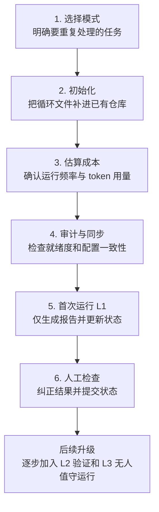

<a id="quickstart--5-minutes-to-your-first-loop"></a>
# 快速入门——5 分钟启动你的第一个循环

> **别再反复写提示词。设计循环。获得评分。**

观看评分一路攀升：[loop-audit-demo.gif](../assets/visuals/loop-audit-demo.gif)（约 15 秒内从 10 → 70 → 100）。

从 [X](https://x.com)、[展示页](https://cobusgreyling.github.io/loop-engineering/)或朋友的 README 来到这里？这是从零开始运行循环的最短路径。

**第一周准则：** 仅报告。不要自动修复，也不要自动合并。先阅读循环写入的内容，再允许它执行操作。

## 一眼看懂：从空白配置到可控循环



各阶段会得到这些结果：

- **选择模式：** 确定要解决的重复任务、使用的 pattern，以及承载循环的工具。
- **初始化：** 在现有项目中得到状态、循环配置、预算、运行日志和相应技能等文件。
- **估算成本：** 得到指定级别和执行频率下的 token 用量估算，用来调整频率或级别。
- **审计与同步：** 得到就绪度评分、待补项建议，以及 `STATE.md` 与 `LOOP.md` 的一致性报告。
- **首次运行 L1：** 只报告发现并更新状态，不修改业务代码。
- **人工检查：** 人工确认优先级、修正误判，并提交脚手架和首次运行产生的状态更新。
- **后续升级：** 在运行记录可信后，再加入验证器、隔离工作树、预算和人工审核关卡，逐步尝试 L2/L3。

<a id="1-pick-your-pain-30-seconds"></a>
## 1. 找出你的痛点（30 秒）

不确定该选哪个循环？使用展示页上的[交互式模式选择器](https://cobusgreyling.github.io/loop-engineering/#interactive)——它会推荐一种模式、脚手架命令、第一行 `/loop` 指令以及 token 用量估算。

如果只是想低风险地学习循环规范，也可以从 **Daily Triage** 开始。

<a id="2-scaffold-in-your-repo-60-seconds"></a>
## 2. 在当前仓库中初始化循环脚手架（60 秒）

这里的“初始化循环脚手架”，是指在一个**已有的 Git 项目**中补齐 Loop Engineering 运行所需的状态、规则、预算、日志和工具配置。它不是生成应用功能或业务代码，也不需要先克隆 `loop-engineering` 仓库。

进入任意 Git 项目的根目录并运行以下命令；末尾的 `.` 表示把文件写入当前项目：

```bash
npx @cobusgreyling/loop-init . --pattern daily-triage --tool grok
```

以上面的 `daily-triage` 为例，典型文件的用途如下：

| 文件 | 当前用途 |
|------|----------|
| `STATE.md` | 保存循环的当前状态，包括最近运行时间、高优先级事项、观察列表和本轮忽略的噪声；其他模式可能使用各自的状态文件名。 |
| `LOOP.md` | 描述已启用循环的执行频率、当前级别或状态、人工审核关卡和预算等团队配置。 |
| `loop-budget.md` | 记录所选模式的每日运行次数、token 和子智能体数量上限，以及超出预算后的处理方式和紧急停止开关。 |
| `loop-run-log.md` | 提供仅追加的运行记录格式，用来记录每次运行的模式、耗时、发现项、采取的操作、升级次数、token 估算和结果。 |

因此，这一步的产出是一套可检查、可审计的“循环运行配置”；你的项目源代码和业务实现仍由原来的开发流程管理。

可将 `--pattern` 替换为 [patterns/registry.yaml](../patterns/registry.yaml) 中的任意模式。列出所有模式：

```bash
npx @cobusgreyling/loop-init --help
```

<a id="which---tool-values-work"></a>
### 可以使用哪些 `--tool` 值？

| `--tool` 值 | `loop-init` 是否支持脚手架生成？ | 说明 |
|----------------|---------------------------|-------|
| `grok` | 是（默认） | 原生 `/loop` 调度 |
| `claude` | 是 | 原生 `/loop` + `$skill` 调用 |
| `codex` | 是 | 通过 Automations 选项卡调度 |
| `opencode` | 是 | Cron/systemd + `opencode run` |
| `cursor` | 否——需手动复制 | 复制技能 + `STATE.md`；使用 Automations——参见 [examples/cursor/](../examples/cursor/) |
| `windsurf` | 否——需手动复制 | 复制技能 + `STATE.md`；使用 Workflows——参见 [examples/windsurf/](../examples/windsurf/) |
| `openclaw` | 否——需手动复制 | 复制 `skills/` + `STATE.md`；使用 `openclaw cron`——参见 [examples/openclaw/](../examples/openclaw/) |

`loop-init` 会复制起步套件，创建 `STATE.md`、`LOOP.md`、`loop-budget.md` 和 `loop-run-log.md`，随后**打印你的 Loop Ready 评分**和第一条命令。

<a id="3-check-cost-before-you-schedule-30-seconds"></a>
## 3. 调度前检查成本（30 秒）

```bash
npx @cobusgreyling/loop-cost --pattern daily-triage --level L1 --cadence 1d
```

根据计划运行的内容调整 `--pattern`、`--level`（L1 → L2 → L3）和 `--cadence`。高频循环（例如每 5m 运行一次的 CI Sweeper）可能快速消耗 token——请降低执行频率，或要求先进行可提前退出的问题分诊。

<a id="circuit-breaker-for-l2-loops-optional"></a>
### L2+ 循环的熔断器（可选）

当循环开始无人值守地修复代码时，请接入**熔断器**，使其升级处理，而不是无休止地重试同一故障。对于能够执行修复的模式，`loop-init` 会生成 `loop-ledger.json` 和 `loop-guard` 技能的脚手架；每次重试前都应检查账本：

```bash
npx @cobusgreyling/loop-context --check --ledger loop-ledger.json
```

退出码 `0` = 继续 · `2` = 升级给人工处理。达到最大迭代次数、同一错误连续出现 N×、连续失败次数过多或触及 token 预算上限时，都会触发熔断器。完整 API：[tools/loop-context/README.md](../tools/loop-context/README.md)。

<a id="4-audit-readiness-30-seconds"></a>
## 4. 审计就绪度（30 秒）

```bash
npx @cobusgreyling/loop-audit . --suggest
```

评分范围为 0–100，并提供具体的后续步骤。每次改进后重新运行。当你对评分满意时，可以添加徽章：

```bash
npx @cobusgreyling/loop-audit . --badge
```

<a id="catch-drift-before-you-schedule-loop-sync"></a>
### 调度前发现配置漂移（`loop-sync`）

`loop-audit` 评估就绪度；`loop-sync` 检查 `STATE.md` 与 `LOOP.md` 是否仍然一致。当二者出现漂移时——例如，你编辑 `LOOP.md` 添加了循环，却从未将其接入 `STATE.md`；或者起步套件更新时遗漏了某个文件——调度的循环可能会依据过时指令运行。

```bash
npx @cobusgreyling/loop-sync .
```

以下是刚生成的 daily-triage 脚手架的示例输出：

```
Loop Sync Report
══════════════════════════════════════════════════
Score: 80/100 (healthy)

Found 2 issue(s):

⚠️ Warnings:
   - LOOP.md: LOOP.md does not reference STATE.md
   - STATE.md ↔ LOOP.md: Low structural similarity between STATE.md and LOOP.md

💡 Suggestions:
   - Review STATE.md and LOOP.md for consistency
```

从上往下阅读：首先关注**评分**（70+ 为健康，40–69 为警告，低于 40 则需要处理），随后每条**警告**都会指出哪两个文件不一致，以及不一致之处。在这个示例中，`LOOP.md` 描述的循环从未回指 `STATE.md`——脚手架刚生成时出现这种情况属于预期，但自定义任一文件后就值得修复。

**运行时机：** 编辑 `LOOP.md` 后运行一次，并在调度 L2 循环前再次运行——这样，无人值守的任务就不会基于过时状态启动。完整检查项、选项和评分区间：[tools/loop-sync/README.md](../tools/loop-sync/README.md)。

<a id="optional-mcp-runtime-lookup"></a>
### 可选：MCP 运行时查询

智能体可以按需查询模式、技能和状态，无需将文档塞进每个提示词。将 [examples/mcp/loop-engineering.mcp.json](../examples/mcp/loop-engineering.mcp.json) 中的配置存根复制到 MCP 客户端设置中。

从 npm 运行服务器（无需克隆）：

```bash
LOOP_PROJECT_ROOT=. npx @cobusgreyling/loop-mcp-server
```

或者从已克隆的 `loop-engineering` 仓库运行，以便进行本地开发：

```bash
cd path/to/loop-engineering/tools/mcp-server && npm ci && npm run build
LOOP_PROJECT_ROOT=/path/to/your/project node dist/index.js
```

有关资源和工具，请参阅 [tools/mcp-server/README.md](../tools/mcp-server/README.md)。

<a id="5-run-your-first-loop--report-only-2-minutes"></a>
## 5. 运行你的第一个循环——仅报告（2 分钟）

### Grok

> 中文说明：以下为供智能体执行的原始英文指令，为避免语义漂移保持不变

```bash
/loop 1d Run loop-triage. Update STATE.md. No auto-fix in week one.
```

### Claude Code

> 中文说明：以下为供智能体执行的原始英文指令，为避免语义漂移保持不变

```bash
/loop 1d Run $loop-triage. Read STATE.md. Merge findings into High Priority and Watch List. Update Last run. Do not edit code.
```

### Codex

使用 `loop-init` 打印的首次运行命令（针对具体模式）。第一周仅执行问题分诊和状态更新。

### OpenClaw

目前尚不支持 `loop-init --tool openclaw`——请复制 `skills/loop-triage/SKILL.md` 和 `STATE.md`，再创建隔离的 cron 作业。参见 [examples/openclaw/daily-triage.md](../examples/openclaw/daily-triage.md)。

### Opencode

```bash
npx @cobusgreyling/loop-init . --pattern daily-triage --tool opencode
```

然后使用 cron 或 systemd 进行调度——每次触发都会通过 `opencode run` 以无头模式运行：

> 中文说明：以下为供智能体执行的原始英文指令，为避免语义漂移保持不变

```bash
opencode run "Run loop-triage. Read STATE.md first. Update High Priority and Watch List. No auto-fix in week one." --agent loop-triage
```

有关 Git 工作树 + 验证器模式（L2+），请参阅 [examples/opencode/daily-triage.md](../examples/opencode/daily-triage.md)。

### Hermes

目前尚不支持 `loop-init --tool hermes`——请手动安装 `loop-triage` 技能，并通过 `hermes cron` 调度。有关设置、频道交付和完整命令参考，请参阅 [examples/hermes/daily-triage.md](../examples/hermes/daily-triage.md)。

第一周请使用 `--deliver local`，让常规问题分诊输出暂不进入聊天记录，直到你信任它为止。

### Cursor

目前尚不支持 `loop-init --tool cursor`——请从任一起步套件复制技能和状态，再将调度映射到编辑器的 Automations。参见 [examples/cursor/daily-triage.md](../examples/cursor/daily-triage.md)。

### Windsurf

目前尚不支持 `loop-init --tool windsurf`——请从任一起步套件复制技能和状态，再将调度映射到 Cascade Workflow。参见 [examples/windsurf/daily-triage.md](../examples/windsurf/daily-triage.md)。

<a id="github-actions-only"></a>
### 仅使用 GitHub Actions

[examples/github-actions/](../examples/github-actions/) 中的工作流示例具有完整的 schema；你需要接入智能体调用（Codex API、`repository_dispatch` 等）。起步阶段应仅将报告输出到状态文件或 Issue 评论。

<a id="6-read-the-output-commit-state-1-minute"></a>
## 6. 阅读输出并提交状态（1 分钟）

打开 `STATE.md`。循环是否捕捉到了真正的优先事项？发现错误就进行修改——你依然是工程师。

提交脚手架和首次运行更新，使 `loop-audit` 能在下一次审计时发现活动记录。

<a id="what-next"></a>
## 接下来做什么？

| 时机 | 操作 |
|------|---------|
| 第一周结束时 | 重新运行 `loop-audit . --suggest`——以 L1（评分约 40+）为目标 |
| 第二周 | 添加验证器技能；在 Git 工作树中尝试一次辅助修复（L2）——参见下文的 [loop-worktree](#l2-isolated-fix-attempts-loop-worktree) |
| 无人值守运行前（L3） | 填写 `loop-budget.md` + `loop-run-log.md`，在 `LOOP.md` 中设置人工审核关卡，并积累经过验证的运行记录 |
| 不确定选择哪种模式 | [模式选择器](./pattern-picker.md) · [循环设计检查清单](./loop-design-checklist.md) |
| 出现故障 | [失效模式](./failure-modes.md) · [案例故事](../stories/) |

<a id="l2-isolated-fix-attempts-loop-worktree"></a>
### L2：隔离的修复尝试（`loop-worktree`）

PR Babysitter 和 CI Sweeper 需要**每次修复尝试使用一个 Git 工作树**，避免重试在同一分支上发生冲突。`loop-worktree` 会在清单中跟踪这些工作树，并清理被拒绝的尝试。

```bash
# 为一次修复尝试创建隔离的 Git 工作树
npx @cobusgreyling/loop-worktree create --run-id pr-217-fix-1 --pattern pr-babysitter

# 在 create 打印的 Git 工作树路径中运行修复，然后运行验证器……

# 验证器拒绝——标记为待清理（仅保留审计记录）
npx @cobusgreyling/loop-worktree mark --run-id pr-217-fix-1 --status rejected

# 清理超过 24h 的 rejected/escalated Git 工作树
npx @cobusgreyling/loop-worktree cleanup --older-than 24h

# 列出活跃的 Git 工作树
npx @cobusgreyling/loop-worktree list
```

将其与上文的[熔断器](#circuit-breaker-for-l2-loops-optional)配合使用：当 `loop-context --check` 以退出码 `2` 结束时，先将 Git 工作树标记为 `escalated`，再移交给人工处理。这两个工具彼此独立——参见 [tools/loop-worktree/README.md](../tools/loop-worktree/README.md)。

<a id="copy-paste-cheat-sheet"></a>
## 复制粘贴速查表

```bash
# 脚手架生成——--tool 接受：grok | claude | codex | opencode
# （cursor、windsurf、openclaw：需手动复制——参见第 2 节表格）
npx @cobusgreyling/loop-init . --pattern daily-triage --tool grok

# 列出模式和选项
npx @cobusgreyling/loop-init --help

# 成本检查
npx @cobusgreyling/loop-cost --pattern daily-triage --level L1 --cadence 1d

# 审计 + 建议
npx @cobusgreyling/loop-audit . --suggest

# 可选：在 README 中添加徽章
npx @cobusgreyling/loop-audit . --badge

# 检查 STATE.md ↔ LOOP.md 漂移（编辑 LOOP.md 后、调度 L2 前运行）
npx @cobusgreyling/loop-sync .

# 可选：MCP 运行时查询（按需查询模式、技能和状态）
LOOP_PROJECT_ROOT=. npx @cobusgreyling/loop-mcp-server

# L2：每次修复尝试使用一个隔离的 Git 工作树（PR Babysitter、CI Sweeper）
npx @cobusgreyling/loop-worktree create --run-id <id> --pattern <pattern>
npx @cobusgreyling/loop-worktree mark --run-id <id> --status rejected
npx @cobusgreyling/loop-worktree cleanup --older-than 24h
```

<a id="learn-the-why-optional-10-minutes"></a>
## 了解背后的原理（可选，10 分钟）

- [Loop Engineering 文章](https://cobusgreyling.substack.com/p/loop-engineering)——概念与原语
- [原语矩阵](./primitives-matrix.md)——Grok vs Claude vs Codex vs OpenClaw vs Opencode vs Cursor
- [运行循环](./operating-loops.md)——何时停止循环

---

*有问题？前往 [GitHub Discussions](https://github.com/cobusgreyling/loop-engineering/discussions) · 通过 [Add Adopter](https://github.com/cobusgreyling/loop-engineering/issues/new?template=add-adopter.yml) 分享你的设置*
