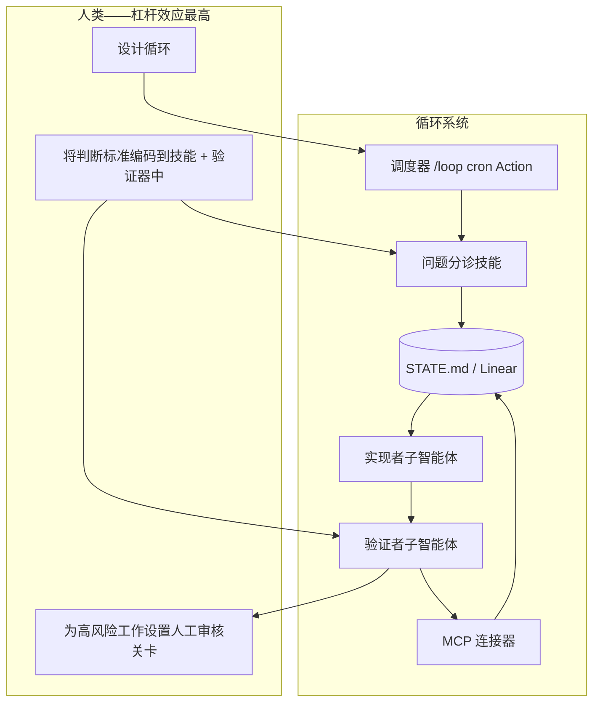

<a id="concepts--vocabulary"></a>
# 概念与术语

循环工程属于智能体软件开发的一系列理念。本术语表梳理了这些理念之间的联系，帮助你用正确的心智模型设计循环。

<a id="loop-engineering"></a>
## 循环工程（Loop Engineering）

**让系统接替你提供提示词。** 你需要设计一个能够发现任务、分配任务、验证结果并持久化状态的系统，而不再亲自输入下一个提示词。

循环是一种**递归目标**：先定义目的，再让智能体借助子智能体和外部记忆持续迭代，直至任务完成，或由循环将问题升级给人类处理。

<a id="related-concepts-addy-osmani"></a>
## 相关概念（Addy Osmani）

<a id="agent-harness-engineering"></a>
### 智能体运行框架工程（Agent Harness Engineering）

**单个智能体**的运行环境，包括工具、上下文、权限和规则。智能体运行框架是沙箱；循环则负责随时间推移对运行框架的各次运行进行**调度和编排**。

```
智能体运行框架 = 单次会话配置
循环           = 智能体运行框架 + 调度 + 状态 + 验证链
```

<a id="the-factory-model"></a>
### 工厂模型（The Factory Model）

负责**构建**软件的系统，包括流水线、智能体、检查和交接。循环工程关注的是如何运营整个工厂车间，而不是手工组装每一个产品。

<a id="intent-debt"></a>
### 意图债务（Intent Debt）

每次会话开始时，智能体都没有先前的上下文。缺失的意图会被看似自信的猜测填补。**技能**是偿还意图债务的方式：将约定、构建步骤和“我们不这样做”一次写清，供智能体每次运行时读取。

<a id="comprehension-debt"></a>
### 理解债务（Comprehension Debt）

仓库中实际存在的内容与你真正理解的内容之间存在差距。循环越快，交付的非你亲手编写的代码就越多；除非你**阅读循环产出的内容**，否则理解债务会持续增长。

<a id="cognitive-surrender"></a>
### 认知让渡（Cognitive Surrender）

这是一种陷阱：你让循环持续运行，自己却不再作出判断。带着判断力设计循环是解药；利用循环逃避思考则会加速问题恶化。同样的行为，结果截然相反。

<a id="orchestration-tax"></a>
### 编排税（Orchestration Tax）

协调并行智能体所产生的人力成本，包括审查能力、合并冲突和上下文切换。**Git 工作树**可以消除机械性的冲突，但你能消化多少个并行循环，最终仍取决于自身能力上限。

<a id="code-agent-orchestra--adversarial-code-review"></a>
### 编码智能体编排／对抗式代码审查（Code Agent Orchestra / Adversarial Code Review）

一种结构化模式：由不同智能体承担不同角色（探索、实现、验证）。实现者绝不能自行评判自己的工作。这对于**无人值守**循环至关重要。

<a id="the-six-primitives--memory"></a>
## 六大原语（+ 记忆）

参阅 [primitives.md](./primitives.md) 和 [primitives-matrix.md](./primitives-matrix.md)。

1. 自动化／调度
2. Git 工作树
3. 技能
4. 插件与连接器（MCP）
5. 子智能体（执行者／检查者）
6. **+ 记忆／状态**（外部、持久）

<a id="concept-map"></a>
## 概念图



<a id="where-to-go-next"></a>
## 后续阅读

- [循环设计检查清单](./loop-design-checklist.md) — 发布循环前
- [失效模式](./failure-modes.md) — 循环出错时
- [运行循环](./operating-loops.md) — 成本、日志记录以及何时暂停
- [安全](./safety.md) — 生产环境护栏
