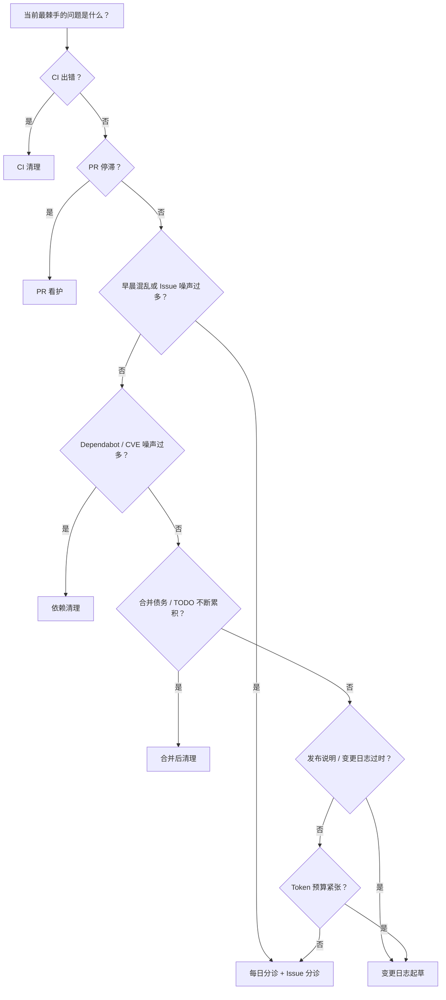

<a id="which-pattern-when"></a>
# 何时选择哪种模式？

每个关注点选择一个主要循环。循环重叠时需要协调——参见[多循环协作](./multi-loop.md)。



<a id="cost-aware-picks"></a>
## 考虑成本的选择

调度前先进行估算：

```bash
npx @cobusgreyling/loop-cost --pattern <id> --level L1
npx @cobusgreyling/loop-init . --pattern daily-triage --tool grok   # 生成 loop-budget.md + loop-run-log.md
```

| 情况 | 推荐 | 避免（直到具备预算和及早退出机制） |
|-----------|--------|-----------------------------------|
| 业余项目 / 方案受限 | 变更日志起草、每日分诊（L1）、合并后清理 | 每 5m 运行 CI 清理、每 5m 运行 PR 看护 |
| CI 故障频发 | 每 **15m+** 运行一次带及早退出机制的 CI 清理 | main 正常时仍每 5m 进行完整分诊 |
| 有许多开放的 PR | 每 10–15m 运行 PR 看护，先以 L1 监控 | 每次触发都运行 L2 修复循环 |
| 发布周 | 每天进行变更日志起草 | 无人值守运行依赖清理 + CI 清理 |

在 `loop-budget.md`、`loop-run-log.md` 和 `LOOP.md` 的预算章节就绪前，`loop-audit` 会限制使用 **L3**。

<a id="quick-reference"></a>
## 快速参考

| 现象 | 模式 | 起步配置 |
|---------|---------|------------|
| main 或 PR 上 CI 失败 | [CI 清理](../patterns/ci-sweeper.md) | L2、15m 运行节奏、最多尝试 3 次 |
| PR 等待审查 / CI / 变基 | [PR 看护](../patterns/pr-babysitter.md) | L1 监控 → L2 辅助修复 |
| 每天早晨都在问“我该做什么？”或 GitHub Issue 噪声过多 | [每日分诊](../patterns/daily-triage.md) + [Issue 分诊](../patterns/issue-triage.md)（新增） | **第 1 周使用 L1 仅报告模式**——风险低、组合效果极佳 |
| 过时的软件包 / CVE 警报 | [依赖清理](../patterns/dependency-sweeper.md) | L2 仅补丁，禁止主版本升级 |
| 合并后的 TODO 和清理事项 | [合并后清理](../patterns/post-merge-cleanup.md) | L1 非高峰时段，仅做小范围修复 |
| 发布说明过时或缺失 | [变更日志起草](../patterns/changelog-drafter.md) | **L1**（开始时仅生成草稿），风险极低 |

<a id="overlap-rules"></a>
## 重叠规则

| 组合 | 规则 |
|-------------|------|
| CI 清理 + PR 看护 | CI 清理负责失败的检查；PR 看护不会在同一小时内再次修复同一分支 |
| 每日分诊 + 任何模式 | 每日分诊负责报告，操作循环负责执行。L1 下分诊不会自动修复 |
| 依赖清理 + CI 清理 | main 上 CI 出错时暂停依赖清理 |
| 合并后清理 + PR 看护 | 合并后清理仅在非高峰时段运行 |
| 变更日志起草 + 任何模式 | 变更日志起草以读取为主，可安全地与其他模式同时运行；它不应自动发布 |

<a id="first-loop-recommendation"></a>
## 首个循环建议

如果不确定，请从 **L1 每日分诊**开始。它能帮助你养成状态管理规范，又不会带来自动合并风险。

```bash
npx @cobusgreyling/loop-init . --pattern daily-triage --tool grok
npx @cobusgreyling/loop-audit . --suggest
```
